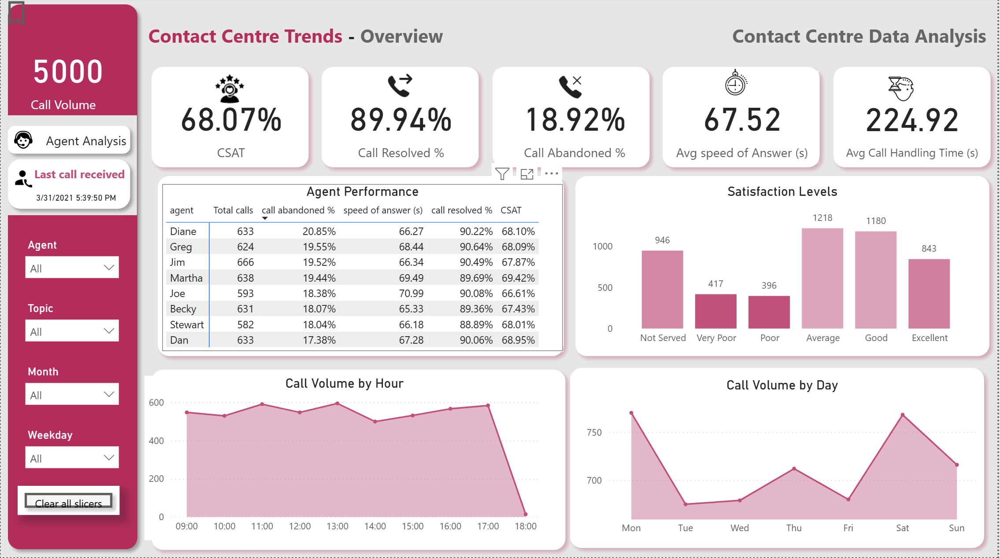
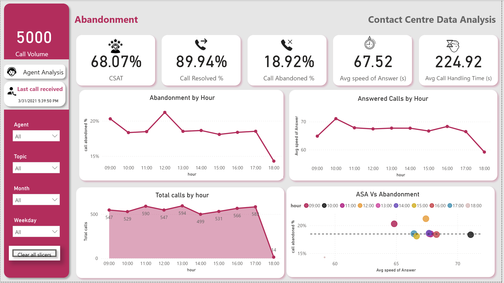

# Contact Centre Performance Analytics | Power BI

## Project Overview

This project analyzes **5,000 customer service call records** to evaluate contact centre performance, identify operational bottlenecks, and highlight opportunities to improve service efficiency and customer experience.

Using **Power BI**, I developed an interactive dashboard to monitor key performance indicators (KPIs), compare agent performance, investigate call abandonment patterns, and examine how call volume and response times vary throughout the day.

## Business Objectives

- Monitor contact centre performance using consistent operational KPIs.
- Identify periods with elevated call abandonment and response times.
- Compare agent workloads, resolution rates, and customer satisfaction.
- Explore potential relationships between call demand, speed of answer, and abandonment.
- Support data-informed decisions about staffing, workload distribution, and service improvements.

## Tools & Techniques

- **Power BI:** Interactive dashboards, DAX measures, data modelling, and filtering.
- **Power Query:** Data preparation and transformation.
- **Data analysis:** KPI definition, trend analysis, agent-level performance comparisons, and operational investigation.

## Key Performance Indicators

| Metric | Dashboard Result |
|---|---:|
| Total Calls | 5,000 |
| Call Resolution Rate | 89.94% |
| Call Abandonment Rate | 18.92% |
| Customer Satisfaction (CSAT) | 68.07% |
| Average Speed of Answer | 67.52 seconds |
| Average Handling Time | 224.92 seconds |

> **Note:** KPI definitions and denominators need to be checked against the report's DAX measures before publication.

## Dashboard Pages

### 1. Contact Centre Overview

Provides an operational performance summary through KPI cards, agent-level comparisons, customer satisfaction distributions, and call volume trends.



### 2. Call Abandonment Analysis

Examines hourly abandonment rates, call demand, and average speed of answer to identify periods that warrant further investigation.



### 3. Interactive Filtering

Enables users to explore performance by **agent, topic, month, and weekday**.

## Analytical Findings

The dashboard highlights several areas for further investigation:

- Overall call abandonment is approximately **19%**, making abandoned contacts an important operational metric to monitor.
- Customer satisfaction is approximately **68%**, suggesting an opportunity to investigate service experience and potential improvement areas.
- Call volume and operational performance vary throughout the day, supporting more detailed analysis of demand and staffing coverage.
- Agent-level comparisons make it possible to investigate variations in workload, response times, and service outcomes.

These observations are descriptive and do not establish causal relationships.

## Potential Business Recommendations

1. Review hourly abandonment rates alongside call volume and staffing coverage to identify potential service bottlenecks.
2. Investigate periods with slower response times and compare them with abandonment trends.
3. Use agent-level performance reporting to identify coaching and workload-management opportunities.
4. Monitor customer satisfaction alongside operational efficiency metrics to avoid optimizing speed at the expense of service quality.

## Data Source

**To complete before publishing:** Add the original dataset link, its usage permissions, reporting period, and a summary of any data preparation performed.

## Repository Structure

```text
contact-centre-performance-analytics/
├── README.md
├── Contact_Centre_Analysis.pbix
├── .gitignore
├── data/
├── images/
│   ├── overview.png
│   ├── abandonment-analysis.png
│   └── data-model.png
└── docs/
    ├── kpi-definitions.md
    └── analysis-and-recommendations.md
```

## Project Files

- `Contact_Centre_Analysis.pbix` — Interactive Power BI report.
- `images/` — Dashboard screenshots.
- `docs/kpi-definitions.md` — KPI definitions and calculations (to be completed).
- `docs/analysis-and-recommendations.md` — Investigation notes and recommendations (to be completed).

## Limitations

This is a portfolio analytics project. Findings should be interpreted in the context of the dataset's scope, reporting period, available fields, and KPI definitions. Recommendations have not been validated through operational implementation.
